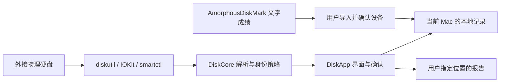

# 架构与数据流

本应用是运行在当前 Mac 用户会话中的桌面工具，没有服务器、后台守护服务或云端数据存储。

## 组成

| 层 | 责任 |
| --- | --- |
| DiskApp | SwiftUI / AppKit 窗口、菜单、用户确认、导出及本地应用状态 |
| DiskCore | 设备模型、发现、SMART 解析、身份与型号策略、OCR、成绩解析和报告 |
| macOS | `diskutil`、IOKit、`system_profiler`、Vision、应用打开和文件选择 |
| smartctl | 独立读取组件，提供 ATA / NVMe 原始数据 |
| AmorphousDiskMark | 独立的外部测速应用，由用户手动开始测速 |

图中的本应用采集路径只读。测速本身由 AmorphousDiskMark 对目标卷执行实际读写，应用不会自动触发。

## 设备发现与更新

`DiskService.scan` 从 `diskutil list -plist external physical` 出发，核实外接、整盘及非虚拟条件，再收集分区和卷。APFS 追踪合成容器中的卷，但不会新增一台物理硬盘。

`AppModel` 监听挂载 / 卸载事件，并默认约每 3 秒检查设备。SMART 结果缓存约 30 秒，强制重新扫描会重读。扫描失败时保留上次数据并明确提示，不能把失败当成所有设备均已拔出。

`CommandRunner` 以可执行文件和参数数组启动进程，分别读取标准输出与错误，设置超时。不要把设备路径或用户输入拼接成 shell 命令。

## SMART 的归一化

`SMARTParser` 消费 smartctl JSON，保留原始文本与 JSON。

- 统一温度、通电、寿命消耗、备用空间、错误和主机读写等指标。
- NVMe 数据单位按每单位 512,000 字节换算；ATA 使用有效的标准设备统计。
- 未知厂商属性保留原值，不从名称不明的属性推断读写量或断电次数。
- 总体通过、明确故障、关注事项和未提供分别表达。
- 退出码和消息结合判断错误：部分扩展日志失败不抹去成功指标，也不自动等于坏盘。

## 三种身份用途

| 用途 | 规则 |
| --- | --- |
| 当前界面 | 当前设备号可用于会话内选择 |
| 历史与测速 | 优先 SMART 序列号，缺失时使用唯一卷 UUID |
| 料号补充 | 仅使用可靠的唯一物理序列号，优先硬件层序列号 |

重复标识会被禁用，避免同型号、多卷或克隆卷串联记录。硬件层与 SMART 内部序列号可能不同，不能默认两者必然相等；设备号、卷名和挂载路径不能作为物理设备的长期身份。

保存时重新检查目标是否还连接并且唯一，不能只依赖打开对话框时保存的设备快照。

## 型号与链路

`DeviceCatalog` 区分接口返回的 Model、产品系列与标签型号 / 料号。设备原文、厂商规则与用户确认均有独立来源，补充信息不会改写原始字段。具体规则见[型号识别说明](model-identification.md)。

USB 硬件属性只从当前盘的 IOMedia 父链读取。NVMe 的 USB4 信息通过当前盘的 PCI 隧道路径定位外壳，再按 UID 对应 `system_profiler` 的当前链路速率。不能全局按名称找一台同型号设备，不能将扩展坞能力当成下游 USB 硬盘能力。

## 本地存储与导出

`history.json` 保存首次记录时间、温度与测速成绩；`device-labels.json` 保存已确认的盘身型号或料号、来源和时间。两者均在当前用户的 Application Support 下，采用原子写入。读入失败时保留原文件；不会用空记录自动覆盖。

报告由 `ReportBuilder` 组合当前设备数据、来源说明和关联的测速结果；原始 SMART 保留原样。用户在保存面板中选择导出位置，只有这一步可能将报告写到移动硬盘。

## 标签照片与测速成绩

照片由本地 Vision 识别，限制文件大小，提取完整料号候选；不猜模糊字符，不持久保存照片。识别在后台队列执行，结果回填仍需用户确认；超时或格式错误有可恢复提示。

测速只打开外部工具。导入支持完整 AmorphousDiskMark 文字成绩，校验全部读写项目、数值及重复行；成绩不含可靠序列号，保存前由用户确认目标。已有相同原文不重复保存，每盘最多保留 30 份。
